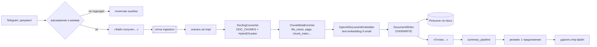
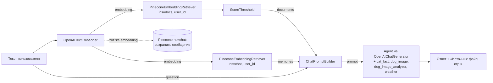
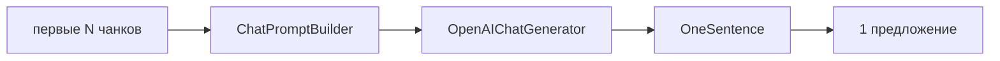

# hay_v2_bot — поиск по своим документам в Telegram

Домашнее задание к уроку **VPg07. Кейс 3: Поиск по своим данным**. Используются Haystack Pipelines, Docling, Pinecone и Telegram.

Это вторая версия персонального ассистента из VPg06. Старый функционал сохранён: факт о кошках, картинка собаки с определением породы, погода и долговременная память в Pinecone. К нему добавлена работа с файлами. Пользователь присылает PDF, DOCX, PPTX, HTML или MD. Бот разбирает файл через Docling, режет его на чанки, сохраняет эмбеддинги в Pinecone и пишет резюме файла одним предложением. После этого на вопросы по содержимому бот отвечает со ссылкой на файл и страницу.

## Возможности

| Что | Как |
|---|---|
| Ответы по загруженным файлам со ссылкой на источник | `generation_pipeline`: поиск в namespace `docs` |
| Память диалога | namespace `chat`, сохраняется только текст пользователя |
| Факт о кошках | инструмент `cat_fact` (catfact.ninja) |
| Случайная собака и её порода | `dog_image` (dog.ceo) и `dog_image_analyzer` (vision-модель OpenAI) |
| Погода | инструмент `weather` (Open-Meteo, без ключа) |
| Загрузка файла | `ingestion_pipeline`: Docling, OpenAI-эмбеддинги, Pinecone |
| Резюме файла | `summary_pipeline`: ровно одно предложение |

Команды: `/start`, `/help`, `/docs` (список файлов), `/cleardocs` (удалить файлы), `/clear` (очистить память диалога, файлы не трогает).

## Архитектура

```
hay_v2_bot/
  main.py                          точка входа: конфиг, сборка пайплайнов, запуск бота
  config.py                        чтение .env.local и проверка переменных
  bot/telegram_bot.py              хендлеры /start /help /clear /docs /cleardocs, текст, документы
  bot/files.py                     проверка расширения и размера файла
  components/tools.py              инструменты агента: кошки, собаки, погода
  components/context.py            память диалога в Pinecone (namespace chat)
  components/document_store.py     фабрика PineconeDocumentStore, фильтры по user_id
  components/chunk_meta.py         плоская meta чанков, id, список файлов (без Haystack)
  components/processors.py         свои компоненты: ChunkMetaEnricher, ScoreThreshold, OneSentence
  pipelines/ingestion_pipeline.py  Docling → чанки → эмбеддинги → Pinecone
  pipelines/generation_pipeline.py эмбеддинг запроса → retriever → prompt → LLM
  pipelines/summary_pipeline.py    резюме файла в одно предложение
  pipelines/summary_text.py        приведение текста к одному предложению (без Haystack)
tests/                             pytest без сети и ключей
```

Подробности о входах и выходах каждого компонента — в [ARCHITECTURE.md](ARCHITECTURE.md).

### Загрузка документа



### Ответ на сообщение



### Резюме файла



## Установка и настройка

Всё, что описано ниже, выполняется вручную. Бот ничего не скачивает и не регистрирует сам.

### 1. Python и виртуальное окружение

Нужен **Python 3.11 или новее**: этого требуют `docling-haystack` и `pinecone-haystack`.

```bash
cd vpg07-search-own-data
python3 -m venv .venv
source .venv/bin/activate          # Windows: .venv\Scripts\activate
python -m pip install --upgrade pip
pip install -r requirements.txt
```

**Объём установки.** Docling тянет PyTorch, OCR и модели разметки, поэтому установка заметно тяжелее, чем в VPg06:

- PyTorch ставится как зависимость `docling`. На macOS и Windows это CPU-сборка. На Linux pip по умолчанию может поставить сборку с CUDA, а это несколько гигабайт. Если GPU нет, сначала поставьте CPU-версию: `pip install torch --index-url https://download.pytorch.org/whl/cpu`, потом `pip install -r requirements.txt`.
- GPU не обязателен: Docling работает и на CPU, только медленнее.
- Закладывайте несколько гигабайт свободного места на диске и время на скачивание.

### 2. Первая загрузка моделей Docling

При первой конвертации Docling скачивает модели с Hugging Face: разметку страниц, распознавание таблиц и OCR. Это сотни мегабайт. Модели кэшируются в домашней папке, обычно в `~/.cache/docling/` и `~/.cache/huggingface/`. Поэтому первый файл обрабатывается заметно дольше следующих.

Модели можно скачать заранее, до запуска бота:

```bash
docling-tools models download
```

Если в вашей версии Docling такой команды нет, модели скачаются автоматически при первой обработке файла.

`HybridChunker` скачивает с Hugging Face только **токенизатор** (по умолчанию от модели `all-MiniLM-L6-v2`). Он нужен, чтобы считать длину чанка в токенах. Векторы этим токенизатором не строятся: все эмбеддинги делает OpenAI `text-embedding-3-small` через прокси, а `sentence-transformers` в проекте не используется.

### 3. Индекс Pinecone

1. Зарегистрируйтесь на <https://app.pinecone.io> и скопируйте API-ключ (раздел **API Keys**).
2. Создайте индекс (**Create index**) с такими параметрами:
   - **Dimension:** `1536` (размерность `text-embedding-3-small`);
   - **Metric:** `cosine`;
   - **Capacity mode:** Serverless, **Cloud:** AWS, **Region:** `us-east-1`.
3. Имя индекса укажите в `PINECONE_INDEX`.

Namespace `docs` и `chat` создавать не нужно: Pinecone создаёт их при первой записи. Если индекса с таким именем нет, `PineconeDocumentStore` создаст его сам с параметрами из кода (1536, cosine, serverless aws us-east-1). Надёжнее всё же создать индекс вручную и проверить параметры.

### 4. Токен Telegram-бота

1. Откройте [@BotFather](https://t.me/BotFather) и отправьте `/newbot`.
2. Задайте имя и username бота (username должен заканчиваться на `bot`).
3. Скопируйте токен в `TELEGRAM_BOT_TOKEN`.
4. Команды для меню можно задать через `/setcommands`:
   ```
   start - приветствие и возможности
   help - примеры запросов
   docs - список изученных файлов
   cleardocs - удалить все файлы
   clear - очистить память диалога
   ```

### 5. Ключ ProxyAPI

1. Зарегистрируйтесь на <https://proxyapi.ru> и пополните баланс.
2. В личном кабинете создайте ключ и скопируйте его в `OPENAI_API_KEY`.
3. Оставьте `OPENAI_BASE_URL=https://api.proxyapi.ru/openai/v1`.

Все обращения к OpenAI (чат, эмбеддинги, vision для породы собаки) идут через этот адрес. В Haystack он передаётся параметром `api_base_url`; в коде это делает единственная функция `config.openai_kwargs()`. Если `OPENAI_BASE_URL` пустой, бот не запустится. Тест `tests/test_constraints.py` проверяет, что в коде нет стандартного адреса OpenAI и что каждый компонент OpenAI получает `api_base_url`.

### 6. Файл `.env.local`

```bash
cp .env.local.example .env.local
```

| Переменная | Обязательна | Значение |
|---|---|---|
| `TELEGRAM_BOT_TOKEN` | да | токен от @BotFather |
| `OPENAI_API_KEY` | да | ключ ProxyAPI |
| `OPENAI_BASE_URL` | да | `https://api.proxyapi.ru/openai/v1` |
| `OPENAI_MODEL` | нет | чат-модель, по умолчанию `gpt-4o-mini` (умеет vision) |
| `OPENAI_EMBEDDING_MODEL` | нет | `text-embedding-3-small` (1536) |
| `PINECONE_API_KEY` | да | ключ Pinecone |
| `PINECONE_INDEX` | да | имя индекса |
| `PINECONE_NAMESPACE_DOCS` | нет | namespace документов, по умолчанию `docs` |
| `PINECONE_NAMESPACE_CHAT` | нет | namespace памяти, по умолчанию `chat` |
| `MAX_FILE_SIZE_MB` | нет | лимит размера файла, по умолчанию 20 |
| `DOCS_TOP_K`, `MEMORY_TOP_K` | нет | сколько фрагментов и сообщений искать (5) |
| `DOCS_MIN_SCORE` | нет | порог косинусного сходства для фрагментов (0.3) |
| `SUMMARY_CHUNKS` | нет | по скольким первым чанкам писать резюме (5) |

При старте бот проверяет обязательные переменные. Если какой-то не хватает, он завершается с сообщением, в котором перечислены пустые переменные.

Telegram отдаёт ботам файлы не больше 20 МБ, поэтому `MAX_FILE_SIZE_MB` больше 20 ничего не изменит.

## Запуск

Из корня репозитория:

```bash
source .venv/bin/activate
python -m hay_v2_bot.main
```

Логи пишутся в консоль и в `logs/bot.log`. В них видно этапы ingestion, число чанков, запись и поиск в Pinecone, вызовы инструментов и ошибки с traceback.

Остановка: `Ctrl+C`.

## Тесты

```bash
pytest -q
```

Тестам не нужны сеть и ключи: Docling, OpenAI и Pinecone в них замоканы. Что проверяется:

- meta чанков заполняется (`file_name`, `chunk_index`, `page`, `user_id`, `chat_id`, `uploaded_at`, `source`) и совместима с Pinecone;
- резюме всегда одно предложение, даже если LLM вернул несколько;
- неподдерживаемый формат и слишком большой файл отклоняются;
- конфиг сообщает, каких переменных не хватает;
- поиск фильтруется по `user_id`, `/clear` не трогает документы;
- в коде нет стандартного адреса OpenAI и локальных эмбеддингов;
- инструмент погоды разбирает ответ Open-Meteo (тест перенесён из VPg06).

Несколько тестов собирают настоящие компоненты Haystack. Если пакеты ещё не установлены, pytest пропускает их со статусом `skipped`.

## Сценарий ручной проверки и скриншоты

Ниже описано **ожидаемое** поведение. Реальные ответы бота, резюме и логи вы получите сами после запуска. Скриншоты кладите в папку `screenshots/` под указанными именами.

Для шагов 3–5 удобно взять англоязычную статью в PDF (например, научную статью с arXiv) и любой свой DOCX.

| № | Действие | Что должно произойти | Скриншот |
|---|---|---|---|
| 1 | `/start` | Приветствие и список возможностей, включая работу с файлами | `screenshots/01_start.png` |
| 2 | «Расскажи факт о кошках», «Покажи собаку и определи породу», «Какая погода в Москве?» | Факт на русском; фото собаки и порода с краткой историей; погода с температурой и ветром | `screenshots/02_old_tools.png` |
| 3 | Отправить PDF | Сразу «Файл получен…», через некоторое время «Готово…», затем отдельным сообщением резюме из одного предложения | `screenshots/03_pdf_upload.png` |
| 4 | Отправить DOCX | То же, что в шаге 3 | `screenshots/04_docx_upload.png` |
| 5 | Вопрос по содержимому PDF (на английском, если документ английский) | Ответ по тексту файла и строка «Источник: <файл>, стр. N» | `screenshots/05_question_with_source.png` |
| 6 | `/docs` | Список загруженных файлов с числом фрагментов и датой | `screenshots/06_docs.png` |
| 7 | Терминал во время шагов 3–5 | Строки `Ingestion: Docling вернул чанков=…`, `Ingestion: запись в Pinecone …`, `Поиск по документам: …`, `Поиск в Pinecone: …` | `screenshots/07_logs.png` |

Дополнительно можно проверить:

- отправить `.txt` или `.exe` — бот должен ответить, что формат не поддерживается;
- выполнить `/clear`, затем `/docs` — файлы должны остаться на месте.

### Скриншоты

Сюда вставляются ваши скриншоты после ручной проверки:


## Ограничения

- Файлы обрабатываются по очереди, по одному: Docling тяжёлый, и параллельная обработка на CPU только замедлит всё. Пока идёт обработка, бот отвечает на сообщения.
- `/docs` и `/cleardocs` работают через `filter_documents` из Pinecone, а он возвращает не больше 1000 чанков за раз. Для домашнего задания этого достаточно.
- Повторная загрузка файла с тем же именем заменяет его старые чанки.
- У DOCX, HTML и MD нет страниц, поэтому в ссылке на источник будет только имя файла.
